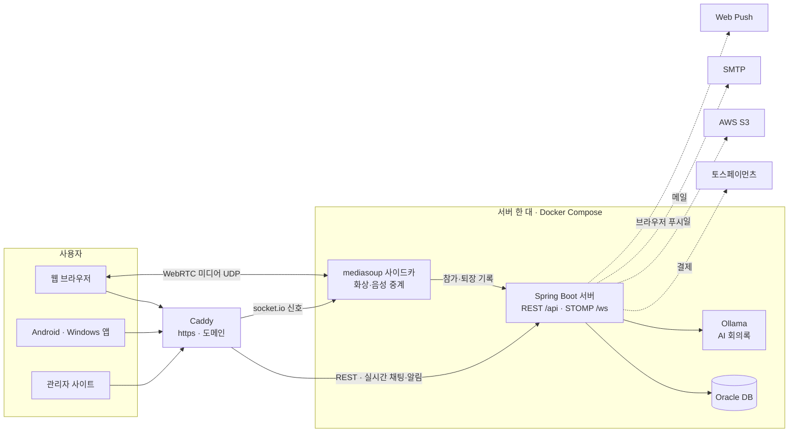

# MQ

**MQ** 는 채팅을 중심으로 한 팀 협업 서비스입니다.
팀을 하나 만들거나 초대 링크로 들어가면, 부서별 채널과 1:1 대화에서 메시지·파일·스레드로 이야기하고,
필요할 때 그 채널에서 바로 음성·화상 회의로 넘어갑니다. 회의가 끝나면 AI 가 요약·결정 사항·할 일을 정리해 채널에 올립니다.

- 웹(브라우저), 관리자 사이트, **Android 앱**, **Windows 앱**에서 같은 계정·같은 데이터로 씁니다.
- 화면은 한국어 · English · 日本語 · 简体中文 4개 언어를 지원합니다.
- 요금제(무료 · Pro · Team · Business)는 팀 소유자가 결제하고, 팀원 전원이 그 플랜의 기능을 씁니다.

> 로컬에서 서버·웹을 켜고 개발하는 방법, DB 규칙, API 목록 같은 자세한 안내는 [docs/development.md](docs/development.md) 에 있습니다.

## 기술 스택

| 영역 | 사용 기술 |
|---|---|
| 웹 · 관리자 사이트 | React 19, TypeScript 7, Vite 8, Tailwind CSS v4, TanStack Query, React Router, i18next, STOMP(실시간), mediasoup-client(화상), MediaPipe(배경·얼굴 효과) |
| 서버 | Kotlin 2.3, Spring Boot 4.1 (Java 21), Spring Security(JWT·OAuth2), Spring Data JPA, WebSocket/STOMP, Web Push(VAPID) |
| 미디어 서버 | Node.js, mediasoup 3 (SFU), socket.io |
| 데이터베이스 | Oracle (로컬: Oracle XE 21c, 운영: Oracle Free 컨테이너) |
| 앱 (Android · Windows) | Kotlin Multiplatform, Compose Multiplatform, Ktor, Koin, DataStore, Coil |
| AI | Ollama `qwen2.5:7b` (무료, 직접 실행) 또는 Claude API (선택) |
| 외부 연동 | 토스페이먼츠(자동결제), AWS S3(파일 저장), Gmail SMTP(메일), Google OAuth(로그인) |
| 배포 | Docker Compose, Caddy(https), 서버 한 대 (iwinv) |

## 아키텍처



- **서버(Spring Boot)** 가 회원·팀·채팅·회의·알림·결제를 모두 맡고 Oracle 에 기록합니다. 새 메시지·알림은 STOMP 로 바로 보내고, 창을 닫은 사람에게는 브라우저 푸시를 보냅니다.
- **mediasoup 사이드카** 는 화상·음성 미디어만 중계합니다. 서버가 발급한 2분짜리 입장 토큰으로만 들어갈 수 있고, 누가 들어오고 나갔는지는 서버에 알려 기록합니다.
- **앱(Android · Windows)** 은 같은 REST API 와 STOMP 를 쓰는 네이티브 앱입니다. 화상회의는 로그인된 상태로 웹 회의실을 엽니다 (Android 는 앱 안, Windows 는 브라우저).
- **관리자 사이트** 는 같은 서버의 `/api/admin` 을 쓰고, 시스템 관리자 계정만 들어갑니다 (대시보드, 에러 기록, 가입 이메일 인증 승인·거절, 결제·환불, DB 데이터 관리).

## 폴더 구조

```
web-rtc-meet-pro/
├─ apps/
│  ├─ client/   웹 (React). 화면은 FSD 구조로 나눈다
│  │            app(라우터·가드) → pages(화면) → widgets(큰 조각: 채팅, 회의실 …)
│  │            → features(사용자가 하는 일 하나) → entities(자료: 팀, 채팅, 회의 …) → shared(공통 UI·요청·다국어)
│  ├─ admin/    관리자 사이트 (React, 별도 도메인 admin.<도메인>)
│  ├─ server/   서버 (Spring Boot). 계층 먼저, 그 아래 도메인
│  │            presentation(컨트롤러) → application(유스케이스) → domain(엔티티·리포지토리 포트)
│  │            infrastructure(DB·파일·결제·메일·푸시 구현), batch(스케줄러), config, common
│  ├─ media/    mediasoup 사이드카 (화상·음성 중계만)
│  └─ kmp/      Android · Windows 앱 (Kotlin Multiplatform)
│     ├─ composeApp/   화면·네비게이션·ViewModel (공통 + androidMain · desktopMain)
│     ├─ androidApp/   Android APK 껍데기 (applicationId, 매니페스트, 아이콘)
│     └─ core/         model(API 자료) · network(Ktor·STOMP) · data(저장·리포지토리) · designsystem(테마·공통 부품)
├─ db/
│  ├─ schema.sql       Oracle 테이블 전체 (지금 버전 v1.10)
│  ├─ migrations/      이미 있는 DB 에 바뀐 부분만 적용 (데이터 유지)
│  └─ seed.sql         플랜 초기값
├─ deploy/      운영 배포: docker-compose.yml, Caddyfile, Dockerfile, 백업 스크립트, .env.example
├─ docs/        개발 안내(development.md), 법적 점검표(legal/), DB 용량 추정
└─ scripts/     VAPID 키 만들기, 오픈소스 라이선스 목록 만들기
```

## 설치 (Android · Windows 앱 빌드)

앱은 소스에서 직접 빌드해서 씁니다. 빌드할 때 **접속할 서버 주소**를 넣습니다 (`-Plimeet.apiUrl`, 웹 주소가 다르면 `-Plimeet.webUrl`).

준비물

- JDK 21
- Android 앱: Android SDK (compileSdk 37. 없으면 Gradle 이 받아 줍니다)
- Windows 앱: Windows PC (설치 파일 도구 WiX 는 빌드할 때 자동으로 받습니다)

### Android

```bash
cd apps/kmp
./gradlew :androidApp:assembleRelease -Plimeet.apiUrl=https://<서버 도메인>
```

- 결과: `apps/kmp/androidApp/build/outputs/apk/release/` 의 APK (서명 전).
  휴대폰에 설치하려면 내 키로 서명합니다 (`apksigner sign --ks <키 파일> <APK>`). 테스트만 할 때는 `assembleDebug` 로 만든 `apk/debug/` 의 APK 를 바로 설치할 수 있습니다.
- 서버 주소를 넣지 않으면 에뮬레이터용 개발 주소(`http://10.0.2.2:8080`)로 붙습니다.

### Windows

```bash
cd apps/kmp
./gradlew :composeApp:packageMsi -Plimeet.apiUrl=https://<서버 도메인>
```

- 결과: `apps/kmp/composeApp/build/compose/binaries/main/msi/MQ-1.0.0.msi` (설치하면 시작 메뉴·바탕화면 바로가기가 생깁니다).
  `.exe` 설치 파일이 필요하면 `packageExe`.
- 설치한 뒤에도 서버 주소를 바꿀 수 있습니다: 실행 옵션 `-Dlimeet.api=…` 또는 환경변수 `LIMEET_API_URL`.

## 라이선스

이 저장소의 코드에는 아직 공개 라이선스를 붙이지 않았습니다. 저작권은 저작자에게 있으며(All rights reserved), 허락 없이 복제·수정·배포할 수 없습니다.

사용한 오픈소스와 각 라이선스는 웹의 `/licenses` 화면(`apps/client/public/oss-licenses.json`, `scripts/oss-licenses.py` 로 만듦)에서 볼 수 있습니다.

## 외부 연동 · 빌드 설정

서버를 켜려면 아래 외부 서비스의 키를 넣어야 합니다. 비워 둔 기능은 꺼진 채로 서버가 뜹니다 (예: 토스 키가 없으면 결제가 막히고, 메일 설정이 없으면 메일 대신 서버 로그에 링크를 찍습니다).

- **로컬 개발**: [`apps/server/.env.example`](apps/server/.env.example) 을 `apps/server/.env.local` 로 복사해서 채웁니다 (`.env.local` 은 GitHub 에 올라가지 않습니다).
- **운영 배포**: [`deploy/.env.example`](deploy/.env.example) 을 `deploy/.env` 로 복사해서 채웁니다 (도메인·DB 비밀번호·JWT 비밀값 등 포함).

| 연동 | 환경변수 | 받는 곳 · 만드는 법 |
|---|---|---|
| 토스페이먼츠 (플랜 자동결제·환불) | `TOSS_CLIENT_KEY`, `TOSS_SECRET_KEY`, `BILLING_KEY_SECRET` | 토스페이먼츠 개발자센터 → API 키 → **API 개별 연동 키** (테스트 `test_`, 운영 `live_`). `BILLING_KEY_SECRET` 은 `openssl rand -hex 32` 로 한 번 만들고 바꾸지 않습니다 |
| AWS S3 (프로필 사진·채팅 첨부·회의 녹화) | `STORAGE_TYPE=s3`, `S3_BUCKET`, `S3_REGION`, `S3_PREFIX`, `S3_ACCESS_KEY`, `S3_SECRET_KEY` | 버킷 하나 + 그 버킷만 읽고 쓰는 IAM 사용자 키. `STORAGE_TYPE=local` 이면 서버 디스크에 저장합니다 |
| Ollama (AI 회의록) | `OLLAMA_URL`, `OLLAMA_MODEL=qwen2.5:7b` | [Ollama](https://ollama.com) 설치 → `ollama pull qwen2.5:7b` → `ollama serve`. 메모리가 8GB 인 서버는 `qwen2.5:3b` 권장 |
| Claude API (선택: 빠른 회의록·실시간 자막) | `ANTHROPIC_API_KEY`, `AI_PROVIDER`, `AI_CAPTION_PROVIDER` | Anthropic Console 에서 API 키. 없으면 Ollama 만 씁니다 (실시간 자막은 Claude 필요) |
| 브라우저 푸시 (창을 닫아도 알림) | `VAPID_PUBLIC_KEY`, `VAPID_PRIVATE_KEY`, `VAPID_SUBJECT` | `python scripts/vapid-keys.py` 로 한 번 만들고 바꾸지 않습니다 (바꾸면 모든 브라우저가 알림을 다시 켜야 함) |
| 메일 (가입 인증·비밀번호 재설정·팀 초대) | `MAIL_HOST`, `MAIL_PORT`, `MAIL_USERNAME`, `MAIL_PASSWORD`, `MAIL_FROM` | Gmail 이면 `smtp.gmail.com` / `587` / 구글 계정의 **앱 비밀번호** (2단계 인증 필요) |
| 구글 로그인 | `GOOGLE_CLIENT_ID`, `GOOGLE_CLIENT_SECRET` | Google Cloud Console → OAuth 클라이언트 ID (웹). 리디렉션 URI `https://<도메인>/login/oauth2/code/google` |
| 화상회의 사이드카 | `MEDIA_JWT_SECRET`, `MEDIA_INTERNAL_SECRET` | 서버와 사이드카에 **같은 값**을 넣습니다 (긴 무작위 문자열) |

앱 빌드 설정: 위 [설치](#설치-android--windows-앱-빌드)의 `-Plimeet.apiUrl` / `-Plimeet.webUrl` (빌드한 앱이 붙을 서버 주소).
